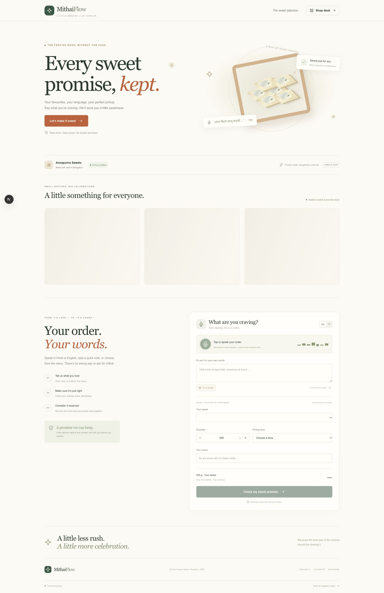
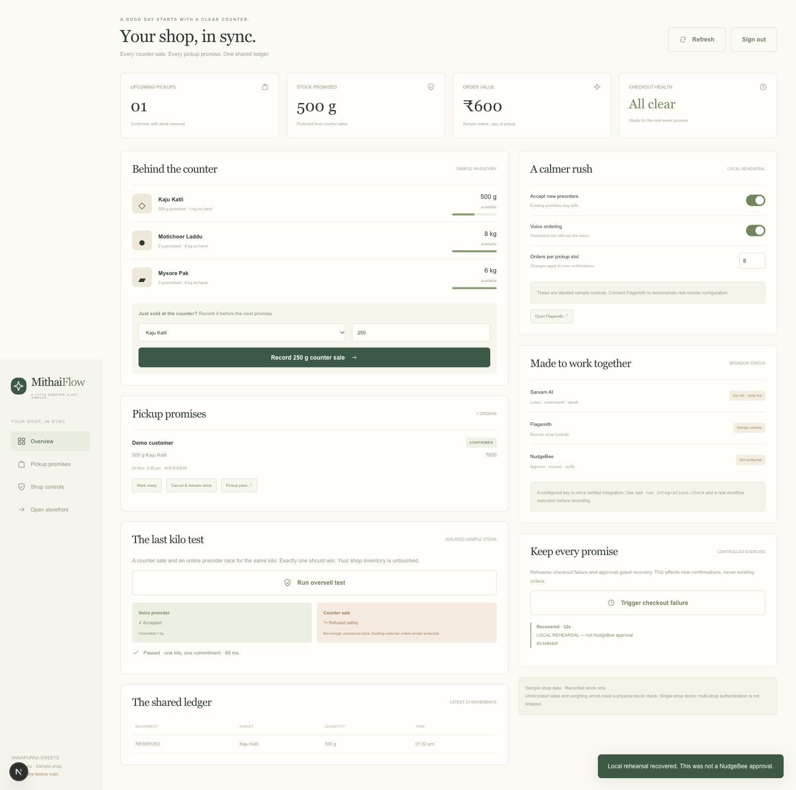
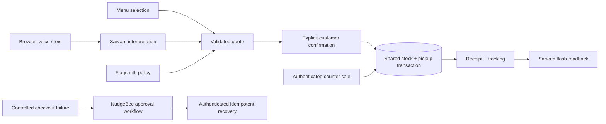

# MithaiFlow

**One stock ledger for the counter and the voice queue.**

During a festive rush, a sweet shop can promise the same stock to a caller and a walk-in customer. MithaiFlow turns Hindi or English requests into reviewable preorders, then reserves actual recorded stock and pickup capacity together. Staff record counter sales against that same balance. The AI interprets language; deterministic code makes every commercial commitment.

Built for Festive Hacks, Bengaluru, 25 November 2026. All shops, products, stock and orders in this demo are fictional sample data. No payments or external customer messages are sent.



## Run locally

Requirements: **Node.js 22+**, npm, and an internet connection for installation and live sponsor calls. Tested with Node.js 24.18. No Docker or database service is needed.

```sh
npm ci
npm run setup
npm run dev
```

Open **http://127.0.0.1:3000**. The protected shop desk is **http://127.0.0.1:3000/shop**. Find `SHOP_PASSWORD` in your private `.env` file. A new checkout gets a randomly generated password and secrets from setup. Never publish `.env` or include it in a demo recording.

Setup generates the Prisma client, applies committed SQLite migrations, and seeds three sweets and tomorrow's pickup slots. Running it again preserves existing stock movements and orders. The seed starts kaju katli with exactly 1 kg available. `DATABASE_URL` defaults to `file:./mithai.db`, relative to `prisma/`.

For a production-style local preview, run `npm run build` then `npm start`. Keep `DEMO_MODE=true` for the hackathon exercise controls.

## The complete customer flow

1. Speak a short Hindi/English request, type an order, or choose the menu. Microphone capture stops at 25 seconds; localhost or HTTPS is required.
2. Review and edit the transcript. Select **Understand order** to interpret it through Sarvam.
3. Check the product, grams, absolute pickup date/time, and your name. Missing details require a choice; the app does not silently substitute a pickup slot.
4. **Check my sweet promise** creates a five-minute quote without reserving stock.
5. **Confirm & reserve** checks the latest commercial rules, computes price from the server catalogue, and reserves stock and pickup capacity in a single transaction.
6. The receipt appears immediately. Spoken readback starts independently; a slow or failed speech request does not undo the order. The private pickup-pass link shows status updates.

Try: **“One kilo kaju katli, actually half a kilo, tomorrow at six pm.”** The expected corrected quantity is **500 g**, priced at **₹600** in the sample catalogue.

## The shop desk

- See physical stock, reserved stock, and available stock separately.
- Record a counter sale before the next preorder commitment.
- Mark a confirmed order ready, then collected. Collection consumes reserved physical stock once.
- Cancel a confirmed, unprepared order to release stock and slot capacity. Ready orders cannot be automatically returned to sellable stock.
- Run the isolated **last kilo test**. An online reservation and counter sale race for a separate sample kilo. The actual shop inventory is untouched.
- Inspect live control values, sponsor status, and controlled checkout incidents.



## Sponsor integrations

| Sponsor | What it does | Implementation |
|---|---|---|
| Sarvam AI | Speech transcription, correction-aware JSON order interpretation, Hindi/English spoken receipt | `src/lib/sarvam.ts`, `src/components/Storefront.tsx` |
| Flagsmith | Server-enforced preorder switch, pickup-slot remote configuration, identity-targeted voice control | `src/lib/flags.ts`, `src/lib/orders.ts` |
| NudgeBee | Receives a controlled failure, requests human approval, calls authenticated recovery, verifies health | `src/lib/ops.ts`, `src/app/api/[...path]/route.ts`, `docs/nudgebee-setup.md` |

Set credentials only in `.env`. `.env.example` describes all variables. Keys never reach browser bundles. `DEMO_MODE=true` enables clearly labelled local controls only when a Flagsmith key is absent. A failed live Flagsmith read does not silently switch to permissive local controls.

### Sarvam

Create a dedicated key in your developer account and set `SARVAM_API_KEY`.

Current defaults: `saaras:v4` for STT, `sarvam-105b` for interpretation, and **`bulbul:v4-flash`** with **`shubh_enhi_ads`** for TTS. Model and speaker must match. Hindi readbacks use the catalogue's Hindi product name and a Hindi-formatted pickup time.

Identical spoken receipts are cached for 15 minutes in a bounded, 64-entry process cache. Concurrent identical TTS requests share one in-flight request. A restart clears this cache. This avoids repeated provider calls; it is not a claim of a distributed cache or a latency guarantee.

### Flagsmith

Set `FLAGSMITH_ENVIRONMENT_KEY` to the **server-side environment key**. Create these enabled features in the same environment:

| Feature | Initial value | Effect |
|---|---|---|
| `accepting_orders` | enabled | New quotes/confirmations are refused when off; existing receipts remain available |
| `pickup_slot_order_limit` | `8` | Numeric remote configuration, validated 1–100; existing orders are preserved when reduced |
| `voice_ordering_enabled` | enabled | Controls microphone access on both browser and server |

Policy reads are cached for up to 10 seconds. The storefront polls every 12 seconds and the shop desk every 6 seconds, so visible changes can take one cache interval plus one polling interval. The server uses the policy at acceptance and stores the accepted snapshot. Material policy changes invalidate a waiting quote and require a new review.

Identity: `customer:<session-cookie>`. The trait `customer_type` is **new** until the session owns a confirmed/ready/collected order, then **regular**. It is derived on the server from order history, not sent by the customer.

To demonstrate segmentation:

1. Set the global `voice_ordering_enabled` flag off.
2. Create segment **regular_customers**, matching `customer_type` equals `regular`.
3. Override `voice_ordering_enabled` to enabled for that segment.
4. In browser A, place a menu order; after the policy refresh, voice becomes available for that session.
5. Open the storefront in a different browser profile/private session B. Voice stays unavailable there; menu ordering still works.

Flags are business controls, not authentication. Staff access uses a separate signed session. If a configured Flagsmith service is unreachable, new confirmations and voice are refused; existing receipts keep working.

### NudgeBee

Follow **[the exact workflow setup](docs/nudgebee-setup.md)**: webhook → GET health → human approval and explicit approve branch → bearer-authenticated POST recovery → GET health again.

Set the actual trigger URL, optional trigger bearer token, public HTTPS tunnel origin, and shared recovery secret. `npm run tunnel:check` checks public health and verifies unauthenticated recovery is rejected. The local recovery button is a separate labelled rehearsal, never evidence of a NudgeBee approval.

## Verification

```sh
npm run typecheck
npm test
npm run build
npm run integrations:check
```

The four automated tests use a separate `prisma/core-test.db`:

1. Competing last-stock confirmations and counter sales produce exactly one commitment (12 race rounds).
2. Retries and unique accepted quotes preserve one order and one notification record.
3. Server catalogue prices override client-supplied totals.
4. Paused ordering refuses new confirmation while existing receipts remain readable.

Tests never reset the demo database. SQLite conditional writes, transaction serialisation, unique constraints, and database triggers protect inventory and slot invariants. Uncertain network outcomes should be retried with the original confirmation key.

`integrations:check` makes a few small real provider calls, writes a redacted report to `docs/evidence/integrations.json`, and marks missing services **NOT CONFIGURED**. Its STT input is generated audio, not a human microphone accuracy benchmark. A NudgeBee webhook acceptance is explicitly distinct from a verified approval/recovery execution. Review the latest report before making sponsor claims.

## Architecture and scaling



The shipped demo is one shop on one persistent process. SQLite serialises writes; do not run independent replicas with separate local databases or deploy this unchanged on ephemeral serverless storage.

For more shops: migrate to shared PostgreSQL; replace the global SQLite write gate with row locks/conditional updates; derive shop scope from authenticated membership; add a shared rate limiter and media cache; and run durable workers with leases if external notifications are added. The current `shopId` fields prepare records for that migration but do not constitute shipped multi-tenant authorisation.

## Known limits

- Inventory means **recorded** stock. Unrecorded sales, spoilage, weighing errors, and reconciliation need an owner check.
- One product per order. No payments, phone-line integration, SMS, WhatsApp, or delivery routing.
- Tracking links are unguessable bearer links; keep them private. Staff actions require authentication.
- Notice records are durable; in-app notice delivery is advanced during page polling. There is no independent distributed notification worker in this MVP.
- Rate limiting and speech caching are per process. They are demo protections, not multi-instance quotas.
- Hindi and English are the supported customer paths. Sample-parser mode is intentionally narrow and visibly labelled.
- The full three-sponsor demo is ready only after the actual Flagsmith controls and NudgeBee approval workflow are configured and verified.

## Credits and disclosure

Built with OpenAI Codex assistance for implementation, tests, documentation, and visual review. The event participant must review and explain the submitted code.

Workflow inspiration: [Sanjay Prasad's Yapping Helper](https://github.com/sanjuhs/yapping-helper), particularly AI interpretation bounded by deterministic execution, visible stages, and reuse of valid work on retries. MithaiFlow does not include its video-rendering code or claim its integrations.

See [DEMO.md](DEMO.md) for the recording sequence and submission copy.
